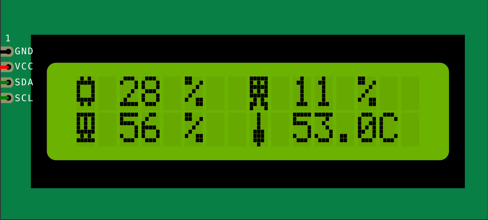

# Performance Monitoring
An arduino firmware, a part of my [Performance Monitoring]() Python program. The arduino will displaying the performance stats for CPU, RAM, GPU, and CPU temperature into an I2C LCD

## LCD Preview

- **Top Left:** CPU
- **Bottom Left:** RAM
- **Top Right:** GPU
- **Bottom Right:** CPU Temperature

## Tested Device Spesification
- **Arduino Board**: Arduino Uno R3
- **LCD**: I2C LCD 16x2

## Developed Environment
- **OS:** Ubuntu 22.04
- **Kernel:** 6.8.0-138-generic
- **Arduino IDE:** 1.8.19